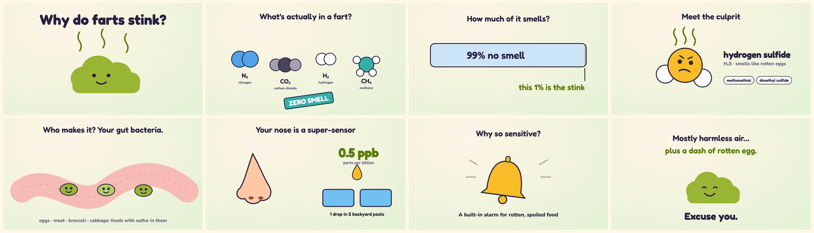
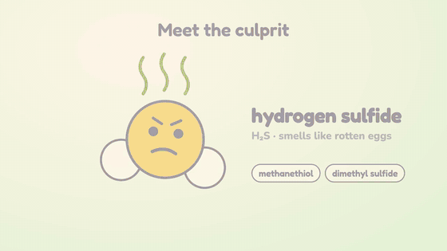

# webshots

**Describe a video. Get a narrated, animated MP4.**



<sub>Every scene of <b>Why do farts stink?</b>, a narrated 95-second explainer made from one sentence. The source is in <code>shots/why-farts-stink/</code>.</sub>

## How to use it

1. Open this folder in an AI coding assistant that can run commands: **ChatGPT (Codex)**, **Claude Code**, **Cursor**, **Gemini CLI**, or similar.
2. Tell it what you want:

   > Make a 60-second video explaining why the sky is blue.

3. Wait a few minutes. Your video appears in `out/`.

That's it. The assistant writes the script, draws and animates every scene, checks them, records them with an AI voice, and hands you the file. The first time, it also installs what it needs, which takes a few minutes.

Ideas to try:
- "A funny 45-second explainer on why cats knock things off tables"
- "Explain how a refund request flows through our support system, for new hires"
- "Same video, but with a British female voice"

### See it move



## 🎵 Music mode

Give it a song instead of a script and it makes a beat-synced, story-driven cartoon music video (no narration):

```bash
npm run new -- my-song --music song.mp3 --lyrics lyrics.txt   # analyzes beats, bars, sections, lyrics
npm run check -- my-song
npm run render -- my-song                                       # out/my-song.mp4, 1920x1080, -14 LUFS
npm run render -- my-song --format vertical --start 40 --end 95 # out/my-song-vertical.mp4, Shorts 1080x1920
```

Needs `pip install --user librosa faster-whisper`. Design and API: [docs/MUSIC_MODE.md](docs/MUSIC_MODE.md). Example: `shots/kingdom-come`.

### Comic mode

The same song can be rendered as a 1990s comic book instead: panels (image model, no text in the art) are
animated with image-to-video clips and laid out on varied overlapping pages, with Bangers lettering for lyric
captions and SFX, halftone and paper grain.

```bash
python3 shots/<name>/make_plan.py                    # plan: spec (draft), prompts.json, motion.txt, plan.md
npm run check -- <name>                              # comic QA must PASS (or scripts/comic_qa.py <spec>)
python3 scripts/comic_render.py <spec> --out DIR     # DIR/<outName>-1080p.mp4 + Short + contact sheets
python3 scripts/comic_render.py <spec> --endcard-test --out DIR   # just a still of the end card
```

- **Trims:** clips play 3.5-4.5 s, the full ~6 s when clean; cut only where morphing starts and say why in `trimNote` (QA max 6 s). Each clip starts one beat (~0.44 s) after its panel lands.
- **End card:** every video and Short ends on a ~3 s held frame reading *BROUGHT TO YOU BY PROGRESSIVE SLOP* / *LIKE AND SUBSCRIBE FOR MORE!* (`spec.endCard`, on by default); the song tail fades out under it (never a hard cut).
- **No clipping (QA):** every caption/SFX box stays inside its panel and the page safe area (measured text bounds); lyric captions stay up until the line is sung (carried onto the splash / next page) and never overlap; song/Short cut points never land mid-word; the end card text fits the title-safe area.
- Full workflow: [docs/COMIC_MODE.md](docs/COMIC_MODE.md) (general rules for every video: [docs/VIDEO_PIPELINE.md](docs/VIDEO_PIPELINE.md)). Examples: `shots/kingdom-come-comic`, `shots/neon-dojo-comic`.

## 🤖 If you're the AI assistant

Read **[`AGENTS.md`](AGENTS.md)** and follow it step by step. It covers setup, writing the narration, building the animation, the visual check, rendering and the hand-off. Keep the user out of the details: do the work, then give them the finished file.

<details>
<summary>How it works (for the curious)</summary>

Each video is a folder in `shots/<name>/` with two hand-made parts:

- **`<name>.scenes.json`:** what the narrator says in each scene.
- **`stage/index.html`:** a 1280×720 web page of SVG drawings, animated with [GSAP](https://gsap.com).

[Argo](https://github.com/shreyaskarnik/argo) then turns those into a video:

1. It generates each line of narration with the [Kokoro](https://github.com/hexgrad/kokoro) voice, locally and for free.
2. Playwright plays each scene in Chromium and holds it until its line ends.
3. ffmpeg mixes the voice in and exports the MP4.

```
narration ──► voice clips ──► clip lengths
                                  │
animation ──► recorded scene by scene, timed to each clip ──► MP4
```

Commands, if you want to drive it by hand:

```bash
npm run setup                          # once
npm run new -- my-video --title "My Video"
npm run check -- my-video              # screenshots of every scene
npm run render -- my-video             # -> out/my-video.mp4
```

**Voices cost nothing by default.** Kokoro is an open-source voice model that runs on your machine, with no account or key. Claude can't speak (its API is text only). If you want a ChatGPT or ElevenLabs voice instead, those are paid APIs that need a key; ask the assistant to switch, and see `AGENTS.md`.

**Requires:** Node 20+ and ffmpeg. The assistant installs them if they're missing and it's allowed to.

</details>

## Credits

[Argo](https://github.com/shreyaskarnik/argo) (MIT) · [GSAP](https://gsap.com) ([standard license](https://gsap.com/standard-license)) · [Kokoro](https://github.com/hexgrad/kokoro) (Apache-2.0) · Playwright · ffmpeg
